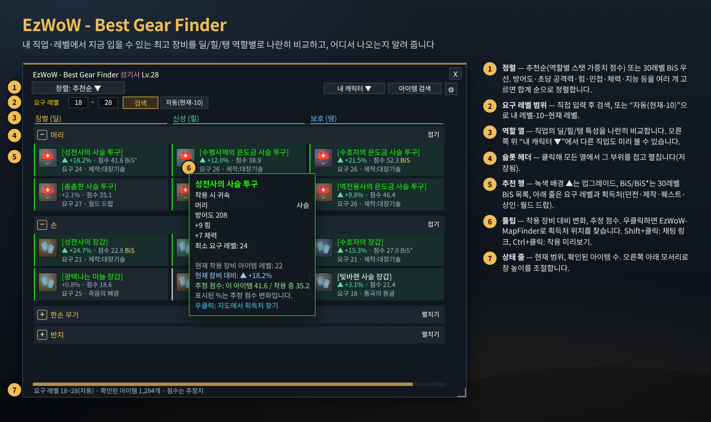
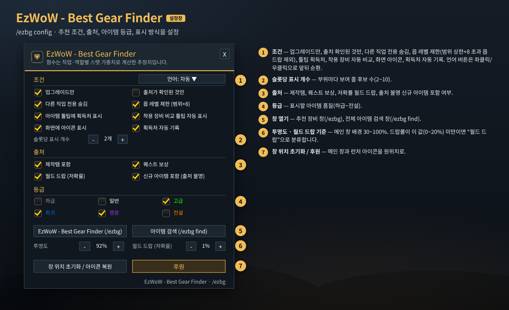
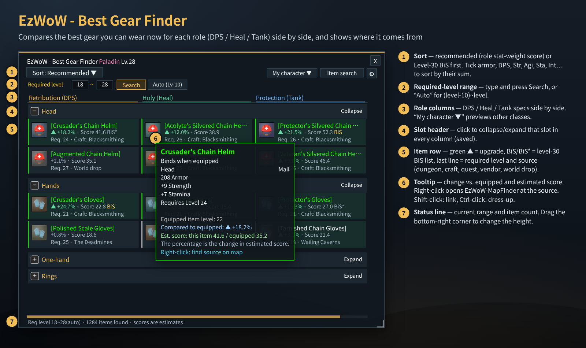
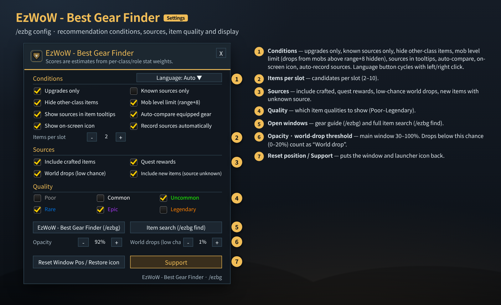

# EzWoW - Best Gear Finder (`EzWoW-BestGearFinder`)

## CurseForge

- **Project ID / 프로젝트 ID:** `1728236`
- **Project page / 프로젝트 페이지:** [EzWoW-BestGearFinder](https://www.curseforge.com/wow/addons/bestgearfinder)

**[한국어](#한국어) · [English](#english)**

WoW Forever (`Interface: 16001`) · `/ezbg`

---

## 한국어

### 개요

내 직업과 레벨에서 **지금 입을 수 있는 가장 좋은 장비**를 부위별로 찾아 주고, 그 장비가 **어디서 나오는지**(던전·보스·드랍률 / 전문기술 제작 / 퀘스트 보상 / 상인 판매)까지 알려 주는 애드온입니다. 직업의 딜·힐·탱 역할을 **나란히 비교**할 수 있고, 지금 입은 장비보다 얼마나 좋은지(추정 점수 변화 %)도 보여 줍니다.

### 화면 미리보기

> 이미지는 애드온 코드의 창 크기·좌표·색상·문구로 재현한 **예시 화면**입니다. 성기사 28레벨 예시이며, 아이템과 점수는 예시입니다.

### 설치

1. `EzWoW-BestGearFinder` 폴더를 `Interface/AddOns/` 폴더에 넣습니다.
2. 캐릭터 선택 화면의 **애드온** 목록에서 켭니다.
3. `/ezbg` 또는 화면의 런처 아이콘(좌클릭)으로 추천 장비 창을 엽니다.

### 추천 장비 창 사용법 (위 그림의 번호)

| 번호 | 부분 | 설명 |
|---|---|---|
| ① | 정렬 | **추천순**(직업·역할별 스탯 가중치 점수, 기본) 또는 **30레벨 BiS 우선**. 방어도·초당 공격력·힘·민첩성·체력·지능·정신력 등을 체크하면 **체크한 값의 합계가 큰 순서**로 정렬합니다. |
| ② | 요구 레벨 범위 | 두 칸에 레벨을 넣고 **검색**(또는 Enter). **자동(현재-10)**은 “내 레벨-10 ~ 내 레벨”로 되돌리며, 레벨이 오르면 같이 올라갑니다. |
| ③ | 역할 열 | 직업의 특성별 열(예: 징벌(딜) · 신성(힐) · 보호(탱))을 나란히 보여 줍니다. 오른쪽 위 **내 캐릭터 ▼**에서 다른 직업을 골라 미리 볼 수 있습니다(이때는 내 장비와 비교하지 않습니다). **아이템 검색**은 전체 아이템 검색 창을 엽니다. |
| ④ | 부위(슬롯) 헤더 | 클릭하면 모든 역할 열에서 그 부위를 접거나 펼칩니다. 접힌 상태는 저장됩니다. |
| ⑤ | 추천 행 | 녹색 배경과 `▲ +%`는 **업그레이드**, 회색 `%`는 참고용, `BiS`(노랑)/`BiS*`(회색)는 30레벨 BiS 목록 1순위/대체 장비입니다. 셋째 줄은 **요구 레벨 · 획득처**(던전 이름, `제작:대장기술`, `퀘스트:…`, `상인:…`, `월드 드랍`)입니다. |
| ⑥ | 아이템 툴팁 | 착용 장비 대비 변화, 추정 점수(이 아이템 / 착용 중)를 보여 줍니다. **우클릭**: EzWoW-MapFinder로 획득처(보스·퀘스트 `Q `·상인 `N `) 위치 검색 / **Shift+좌클릭**: 채팅 링크 / **Ctrl+좌클릭**: 착용 미리보기 |
| ⑦ | 상태 줄 | 현재 요구 레벨 범위와 확인된 아이템 수. 오른쪽 아래 모서리를 끌어 창 높이를 바꿉니다. |

#### 그 밖의 기능

- **퀘스트 수락 레벨 검사**: 지금 레벨(또는 지정한 범위)에서 받을 수 없는 고레벨 퀘스트 보상은 후보에서 뺍니다.
- **획득처 자동 기록**: 전리품, 퀘스트 보상, 상인 목록에서 기본 데이터에 없던 획득처를 배워 바로 추천과 툴팁에 반영합니다(`/ezbg 기록`, `/ezbg 내보내기`).
- **아이템 툴팁 확장**: 가방·보상·채팅 링크 아이템에 역할별 점수 변화와 획득처를 덧붙이고, 착용 장비 비교 툴팁을 함께 띄웁니다.
- **전체 아이템 검색 창** (`/ezbg find 이름`): 이름, 드랍 보스, 요구 레벨, 품질, 획득처 종류, 착용 분류(무기·방어구·방패·성물·목걸이·반지·장신구 등)로 전체 데이터베이스를 찾습니다.

### 설정창 (`/ezbg config`)

| 번호 | 항목 | 설명 | 기본값 |
|---|---|---|---|
| ① | 언어 | 좌클릭/우클릭으로 앞뒤로 순환합니다. | 자동 |
| ① | 업그레이드만 | 지금 장비보다 점수가 높은 것만 표시 | 켬 |
| ① | 출처가 확인된 것만 | 획득처 정보가 있는 아이템만 | 끔 |
| ① | 다른 직업 전용 숨김 | 다른 직업 전용 아이템 제외 | 켬 |
| ① | 몹 레벨 제한 (범위+8) | 요구 레벨 상한보다 8레벨 넘게 높은 몹의 드랍 제외 | 켬 |
| ① | 아이템 툴팁에 획득처 표시 | 기본 툴팁에 드랍 보스·던전·BiS 정보 | 켬 |
| ① | 착용 장비 비교 툴팁 자동 표시 | 목록에 마우스를 올리면 착용 장비 비교창 표시 | 켬 |
| ① | 화면에 아이콘 표시 | 런처 아이콘 | 켬 |
| ① | 획득처 자동 기록 | 루팅·상점에서 새 획득처 기록 | 켬 |
| ② | 슬롯당 표시 개수 | 부위별 후보 수 (2~10) | 2 |
| ③ | 제작템 포함 / 퀘스트 보상 | 전문기술 제작품, 퀘스트 보상 포함 | 켬 / 켬 |
| ③ | 월드 드랍 (저확률) | 드랍률이 기준치보다 낮은 월드 드랍(착용 시 귀속 등) 포함 | 켬 |
| ③ | 신규 아이템 포함 (출처 불명) | 게임에서 새로 확인된 출처 미확인 아이템 포함 | 켬 |
| ④ | 등급 | 하급·일반·고급·희귀·영웅·전설 중 표시할 품질 | 고급·희귀·영웅 |
| ⑤ | 창 열기 버튼 | 추천 장비 창(/ezbg), 아이템 검색 창(/ezbg find) | - |
| ⑥ | 투명도 | 메인 창 배경 30~100% (5% 단위) | 92% |
| ⑥ | 월드 드랍 기준 | 이 확률(0~20%, 0.5% 단위) 미만 드랍은 “월드 드랍”으로 분류 | 1% |
| ⑦ | 창 위치 초기화 / 아이콘 복원 · 후원 | 메인 창과 런처 아이콘 위치 초기화 | - |

### 명령어 (`/ezbg`, `/bgf`, `/bestgear`, `/내템`)

| 명령어 | 설명 |
|---|---|
| `/ezbg` | 추천 장비 창 열기/닫기 |
| `/ezbg config` (`설정`) | 설정창 |
| `/ezbg find 이름` (`검색 이름`) | 전체 아이템 검색 창 |
| `/ezbg 20-35` | 요구 레벨 범위 지정 |
| `/ezbg 제작` · `퀘스트` · `월드드랍` | 제작템 / 퀘스트 보상 / 저확률 월드 드랍 포함 켜기·끄기 (`craft` · `quest` · `worlddrop`) |
| `/ezbg 신규` | 출처 미확인 신규 아이템 포함 켜기·끄기 |
| `/ezbg 등급 녹청보` | 표시 품질 지정 (`하` `일` `녹` `청` `보` `주`, 또는 `quality green blue epic`) |
| `/ezbg 확률 1` (`chance 1`) | 월드 드랍 기준 드랍률(%) |
| `/ezbg 아이콘` (`icon`) | 런처 아이콘 보이기/숨기기 |
| `/ezbg 재검색` (`rescan`) | 신규 아이템 캐시 초기화 후 다시 탐색 |
| `/ezbg 기록` · `/ezbg 내보내기` | 자동 학습한 획득처 수 · 내보내기 창 |
| `/ezbg 슬롯` · `/ezbg 진단` · `/ezbg 왜 아이템ID` | 슬롯별 요약 · 상태 진단 · 특정 아이템이 왜 빠졌는지 |
| `/ezbg 초기화` (`reset`) | 창·아이콘 위치 초기화 |
| `/ezbg lang <auto\|ko\|en\|de\|fr\|es\|ru\|cn\|tw>` | 표시 언어 변경 |

### 저장 데이터

- `EzWoW_BestGearFinderDB`: 설정, 캐릭터별 레벨 범위, 접힌 부위, 창 위치, 자동 학습한 획득처.

### 알아두면 좋은 점

- 점수는 직업·역할별 스탯 가중치로 계산한 **추정치**입니다. 최종 판단은 직접 하세요.
- 아이템 정보는 게임에서 받아오는 데 시간이 걸릴 수 있습니다. 상태 줄에 “불러오는 중”이 보이면 잠시 기다리세요.
- `EzWoW-MapFinder`가 설치되어 있어야 우클릭 위치 검색이 동작합니다.

---

## English

### Overview

Best Gear Finder shows the **best gear you can wear right now** for your class and level, slot by slot, and tells you **where it comes from** (dungeon boss and drop chance / profession craft / quest reward / vendor). DPS, healing and tank roles are **compared side by side**, together with the estimated score change versus what you are wearing.

### Screenshots

> These are **mock-ups** rebuilt from the window sizes, coordinates, colours and strings in the addon code (level 28 Paladin example; items and scores are examples).

### Installation

1. Copy the `EzWoW-BestGearFinder` folder into `Interface/AddOns/`.
2. Enable it in the **AddOns** list on the character select screen.
3. Open the gear window with `/ezbg` or by left-clicking the on-screen launcher icon.

### Using the gear window (numbers in the picture)

| No. | Part | Description |
|---|---|---|
| ① | Sort | **Recommended** (role stat-weight score, default) or **Level 30 BiS first**. Tick armor, DPS, Strength, Agility, Stamina, Intellect, Spirit… to sort by **the sum of the ticked stats**. |
| ② | Required-level range | Enter two levels and press **Search** (or Enter). **Auto (Lv-10)** returns to “your level - 10 ~ your level” and follows you as you level. |
| ③ | Role columns | One column per spec (e.g. Retribution (DPS) · Holy (Heal) · Protection (Tank)). **My character ▼** previews other classes (no comparison with your gear in that mode). **Item search** opens the full item search. |
| ④ | Slot header | Click to collapse/expand that slot in every column. The state is saved. |
| ⑤ | Item row | Green background and `▲ +%` = **upgrade**, grey `%` = reference only, `BiS` (yellow) / `BiS*` (grey) = level-30 BiS main / alternative. The third line shows **required level · source** (dungeon, `Craft: Blacksmithing`, `Quest: …`, `Vendor: …`, `World drop`). |
| ⑥ | Item tooltip | Change versus equipped and estimated score (this item / equipped). **Right-click**: find the source (boss, quest `Q `, vendor `N `) with EzWoW-MapFinder / **Shift+left-click**: link in chat / **Ctrl+left-click**: dress-up preview |
| ⑦ | Status line | Current range and number of items found. Drag the bottom-right corner to change the window height. |

#### More features

- **Quest level check**: quest rewards you cannot pick up yet at your level (or chosen range) are left out.
- **Learning sources**: loot, quest rewards and vendor lists teach the addon sources missing from its data; they show up in recommendations and tooltips at once (`/ezbg 기록`, `/ezbg export`).
- **Item tooltips**: bag, reward and chat-link tooltips get the per-role score change and source, plus the equipped-gear comparison tooltip.
- **Full item search** (`/ezbg find name`): search the whole database by name, boss, required level, quality, source type and equip slot (weapons, armor, shields, relics, necks, rings, trinkets, …).

### Settings window (`/ezbg config`)

| No. | Option | Description | Default |
|---|---|---|---|
| ① | Language | Left/right click cycles forwards/backwards. | Auto |
| ① | Upgrades only | Only items scoring higher than what you wear | On |
| ① | Known sources only | Only items with a known source | Off |
| ① | Hide other-class items | Drop class-restricted items for other classes | On |
| ① | Mob level limit (range+8) | Hide drops from mobs more than 8 levels above the range | On |
| ① | Show sources in item tooltips | Boss, dungeon and BiS info in default tooltips | On |
| ① | Auto-compare equipped gear | Show the equipped comparison when hovering list items | On |
| ① | Show on-screen icon | Launcher icon | On |
| ① | Record sources automatically | Record new sources from loot and vendors | On |
| ② | Items per slot | Candidates per slot (2–10) | 2 |
| ③ | Include crafted items / Quest rewards | Profession crafts and quest rewards | On / On |
| ③ | World drops (low chance) | World drops below the threshold (BoE etc.) | On |
| ③ | Include new items (source unknown) | Items newly seen in the game with no known source | On |
| ④ | Quality | Poor, Common, Uncommon, Rare, Epic, Legendary | Uncommon · Rare · Epic |
| ⑤ | Window buttons | Gear window (/ezbg), item search (/ezbg find) | - |
| ⑥ | Opacity | Main window background 30–100% (5% steps) | 92% |
| ⑥ | World-drop threshold | Drops below this chance (0–20%, 0.5% steps) count as “World drop” | 1% |
| ⑦ | Reset Window Pos / Restore icon · Support | Reset the main window and launcher icon | - |

### Slash commands (`/ezbg`, `/bgf`, `/bestgear`, `/내템`)

| Command | Description |
|---|---|
| `/ezbg` | Open/close the gear window |
| `/ezbg config` | Settings |
| `/ezbg find name` | Full item search window |
| `/ezbg 20-35` | Set the required-level range |
| `/ezbg craft` · `quest` · `worlddrop` | Toggle crafted items / quest rewards / low-chance world drops |
| `/ezbg new` | Toggle new items with unknown source |
| `/ezbg quality green blue epic` | Set visible qualities (`gray white green blue epic legendary`) |
| `/ezbg chance 1` | World-drop threshold (%) |
| `/ezbg icon` | Show/hide the launcher icon |
| `/ezbg rescan` | Clear the new-item cache and scan again |
| `/ezbg learned` · `/ezbg export` | Count of learned sources · export window |
| `/ezbg slot` · `/ezbg diag` · `/ezbg why itemID` | Per-slot summary · diagnostics · why an item is excluded |
| `/ezbg reset` | Reset window and icon positions |
| `/ezbg lang <auto\|ko\|en\|de\|fr\|es\|ru\|cn\|tw>` | Change display language |

### Saved data

- `EzWoW_BestGearFinderDB`: settings, per-character level range, collapsed slots, window position, learned sources.

### Tips

- Scores are **estimates** from per-class/role stat weights. Use your own judgement for the final call.
- Item data can take a moment to load from the game. If the status line says it is loading, wait a little.
- Right-click map search needs `EzWoW-MapFinder` to be installed.

---

## Support / 후원

If you find this addon useful, you can support its development.

애드온이 도움이 되셨다면 개발 후원으로 응원해 주세요.

[Buy Me a Coffee ☕](https://buymeacoffee.com/qqhrqqhr2)

## Automated releases / 자동 릴리즈

GitHub 릴리즈를 게시하면 CurseForge에 자동 업로드합니다. 최초 설정에 Actions Secret `CF_API_TOKEN`이 필요합니다.

Publishing a GitHub release triggers the CurseForge upload workflow. Set the repository Actions secret `CF_API_TOKEN` first.

[Setup and release instructions / 설정 및 배포 방법](docs/RELEASE.md)
