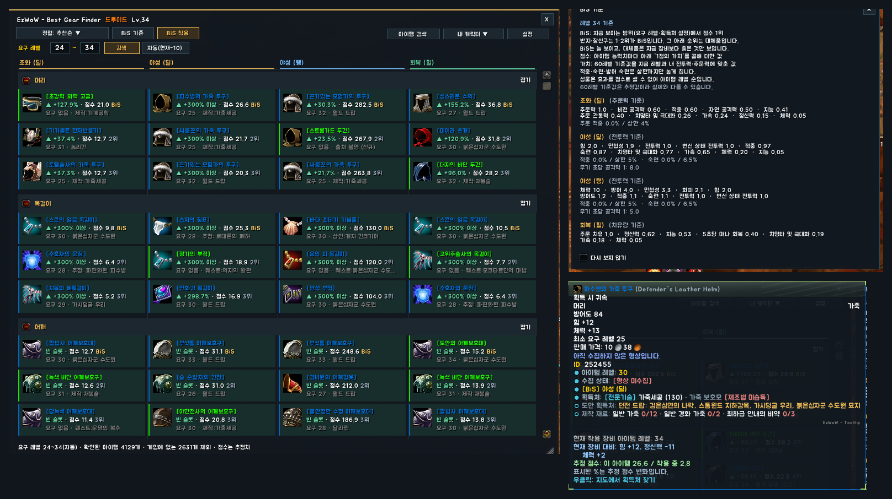
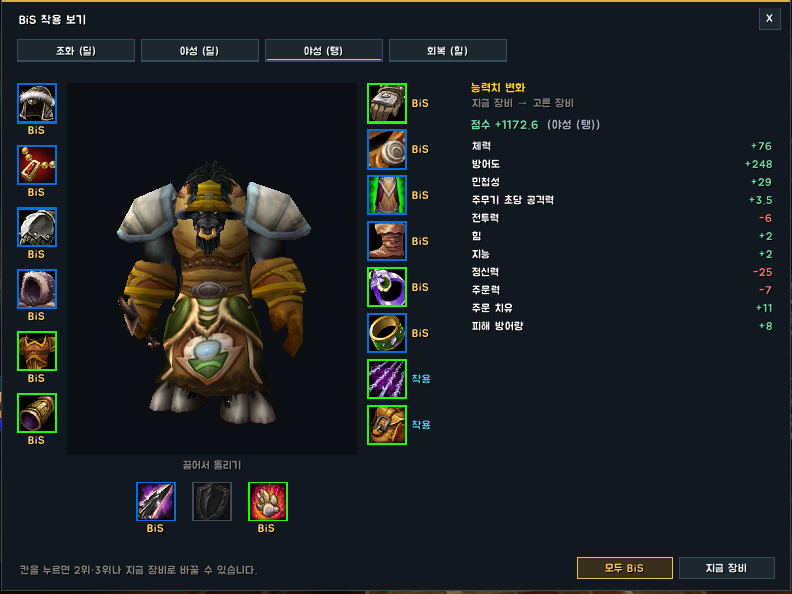
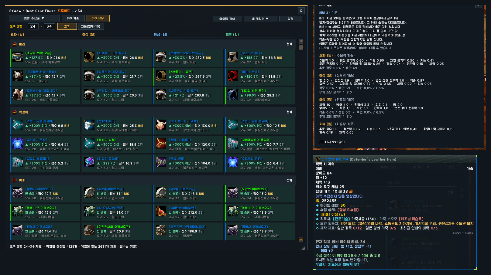
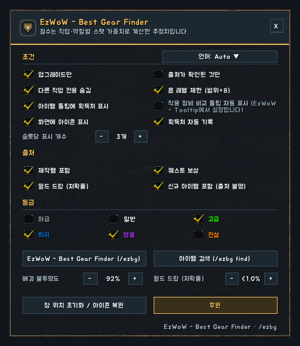

<!--
CurseForge summary (EN): Finds the best gear you can wear right now for your class and level, DPS / heal / tank side by side, and shows where it drops, who crafts it or which quest gives it.
CurseForge summary (KO): 내 직업·레벨에서 지금 입을 수 있는 최고 장비를 딜/힐/탱 나란히 비교하고, 어디서 드랍되는지·누가 만드는지·어떤 퀘스트에서 주는지 알려 줍니다.
-->

# EzWoW - Best Gear Finder

**English** · [한국어](#한국어)

Finds the **best gear you can wear right now** for your class and level, slot by slot, and tells you **where it comes from**: dungeon boss and drop chance, profession craft, quest reward or vendor. DPS, healing and tank specs are compared side by side, with the estimated score change versus what you are wearing.

*In-game screenshots (WoW Forever, Korean client). Character and player names and chat text are blurred.*

## Features

### Gear window (`/ezbg`)
- One column per spec (for example Retribution / Holy / Protection), one block per slot; click a slot header to fold it in every column.
- Sort by recommendation (score from per-spec stat worth) or by the sum of chosen stats (armor, DPS, Strength, Agility, Stamina, Intellect, Spirit).
- The score uses each spec's level-60 stat worth, scaled to your level and your attack / spell power; hit, expertise and defense count fully only up to their caps. The "BiS criteria" button shows the worth of every stat and your hit against the cap.
- **Try on BiS** (`/ezbg bis`): a character-window view with the BiS of every slot on your character's model, the stat and score changes against your current gear, and #2, #3… or your current item to pick per slot.
- Required-level range you can type, or "Auto" (your level - 10 up to your level) that follows you as you level.
- Green rows and ▲ mark upgrades; `BiS` marks the top score in the current range (always listed, `Equipped` when you wear it) and `#2`, `#3`… the alternatives better than your gear; the third line shows the required level and source.
- Hover a row for the comparison with your equipped item and the estimated score. Right-click to find the source on the map (with EzWoW - Map Finder), Shift+click to link, Ctrl+click to preview.
- Preview other classes from the "My character" menu (the class being shown is marked). Drop-down menus close when you click anywhere else.
- Drag the bottom-right corner to change the window height; the background opacity is set in the settings.

### Item tooltips
- Bag, reward and chat-link gear shows BiS per role and the sources; crafted gear also lists reagents and where the recipe is learned.

### Item search (`/ezbg find name`)
- Search the whole database by name, boss, required level, quality, source type and slot (weapons, armor, shields, relics, necks, rings, trinkets…).
- The window can be resized from its bottom-right corner; the size is remembered.

### More
- Learns sources that are missing from its data while you loot, take quest rewards or browse vendors. Grey (junk) items are skipped, and "source recorded" messages that come in during combat are shown after the fight.
- Quest rewards you cannot pick up yet at your level are left out.
- The item list is built in the background in small steps and pauses during combat.

## Working with other EzWoW addons
- **EzWoW - Tooltip**: when this addon shows its source block on a gear tooltip, EzWoW - Tooltip leaves out its own source lines for that item. Comparing with equipped gear without Shift is set in EzWoW - Tooltip; the option here turns grey while it is installed.
- **EzWoW - Map Finder**: right-click a row to find its source on the map.

## Gamepad
- With the gamepad UI on, EzWoW windows work with a gamepad: D-pad to move, A (✕) to press, X (□) for right-click, LB/RB to scroll, B (○) to close. A key guide in your pad's button style shows under the window.
- With no game window open, press **View (Back) / Create** to move to the EzWoW frames on screen. Press it again or B to go back.
- To use another button: Key Bindings > AddOns > EzWoW > "Gamepad: move to / leave the EzWoW frames" (with EzWoW-MapFinder installed).

## Record sharing
- Shared by all EzWoW addons and **on by default**: quest NPCs, rare monster sightings, item drops and gathering spots you have seen yourself are shared with other EzWoW users.
- `/ezshare on` / `off`, `/ezshare channel on` / `off`, `/ezshare status`

## Commands
- `/ezbg` (`/bgf`, `/bestgear`, `/내템`) — open the gear window
- `/ezbg config` — settings
- `/ezbg find name` — full item search
- `/ezbg 20-35` — set the required-level range
- `/ezbg reset` — put the windows and the launcher icon back
- `/ezbg help` — list the commands

Scores are estimates from per-class and per-role stat weights.

Languages: English, 한국어, Deutsch, Français, Español, Русский, 简体中文, 繁體中文.

---

## 한국어

내 직업과 레벨에서 **지금 입을 수 있는 가장 좋은 장비**를 부위별로 찾아 주고, 그 장비가 **어디서 나오는지**(던전 보스 · 드랍률 / 전문기술 제작 / 퀘스트 보상 / 상인 판매) 알려 주는 애드온입니다. 딜 · 힐 · 탱 특성을 나란히 비교하고, 지금 입은 장비보다 얼마나 좋은지(추정 점수 변화 %)도 보여 줍니다.

*실제 게임 화면입니다(WoW Forever, 한국어 클라이언트). 캐릭터 · 다른 플레이어 이름과 채팅 내용은 가렸습니다.*

## 기능

### 추천 장비 창 (`/ezbg`)
- 특성별 열(예: 징벌 / 신성 / 보호), 부위별 묶음. 부위 제목을 누르면 모든 열에서 접고 펼칩니다.
- 추천순(특성별 능력치 가치로 매긴 점수) 또는 고른 스탯(방어도 · 초당 공격력 · 힘 · 민첩성 · 체력 · 지능 · 정신력)의 합계 순으로 정렬.
- 점수는 특성별 60레벨 기준 능력치 가치를 내 레벨과 전투력·주문력에 맞춰 계산하고, 적중 · 숙련 · 방어 숙련은 상한까지만 높게 칩니다. "BiS 기준" 단추로 능력치별 가치와 지금 적중·상한을 볼 수 있습니다.
- **BiS 착용** (`/ezbg bis`): 캐릭터 창 모양으로 부위마다 BiS를 내 캐릭터 모델에 입혀 보고, 지금 장비와 비교한 능력치·점수 변화를 봅니다. 부위마다 2위 · 3위…나 지금 장비로 바꿔 볼 수 있습니다.
- 요구 레벨 범위를 직접 입력하거나 "자동"(내 레벨-10 ~ 내 레벨)으로 두면 레벨이 오를 때 같이 바뀝니다.
- 녹색 행과 ▲는 업그레이드, `BiS`는 지금 범위에서 점수 1위(늘 보이고, 끼고 있으면 `착용 중`), `2위` · `3위`…는 지금 장비보다 좋은 대체품, 셋째 줄은 요구 레벨과 획득처.
- 행에 마우스를 올리면 착용 장비와의 비교와 추정 점수. 우클릭: 지도에서 획득처 찾기(EzWoW - Map Finder), Shift+클릭: 링크, Ctrl+클릭: 미리보기.
- "내 캐릭터" 메뉴에서 다른 직업도 미리 볼 수 있습니다(지금 보고 있는 직업이 표시됨). 펼침 메뉴는 바깥을 누르면 닫힙니다.
- 오른쪽 아래 모서리를 끌어 창 높이를 바꾸고, 배경 불투명도는 설정창에서 정합니다.

### 아이템 툴팁
- 가방 · 보상 · 채팅 링크 장비에 역할별 BiS 여부와 획득처를 표시하고, 제작품은 재료와 도안 배우는 곳까지 보여 줍니다.

### 아이템 검색 (`/ezbg find 이름`)
- 이름 · 보스 · 요구 레벨 · 품질 · 획득처 종류 · 부위(무기 · 방어구 · 방패 · 성물 · 목걸이 · 반지 · 장신구 등)로 전체 데이터베이스를 찾습니다.
- 오른쪽 아래 모서리를 끌어 창 크기를 바꿀 수 있고, 크기는 저장됩니다.

### 그 밖의 기능
- 루팅 · 퀘스트 보상 · 상인 목록에서 데이터에 없던 획득처를 배워 바로 반영합니다. 회색(잡동사니) 아이템은 기록하지 않으며, 전투 중에 기록된 알림은 전투가 끝난 뒤 채팅에 표시합니다.
- 지금 레벨에서 받을 수 없는 퀘스트 보상은 후보에서 뺍니다.
- 아이템 목록은 배경에서 조금씩 만들고, 전투 중에는 잠시 멈춥니다.

## 다른 EzWoW 애드온과 함께 쓰기
- **EzWoW - Tooltip**: 장비 툴팁에 이 애드온의 획득처 블록이 나오면 EzWoW - Tooltip은 그 아이템의 획득처 줄을 생략합니다. "Shift 없이 착용 장비 비교"는 EzWoW - Tooltip에서 설정하며, 설치되어 있는 동안 이 애드온의 해당 칸은 회색이 됩니다.
- **EzWoW - Map Finder**: 행을 우클릭하면 획득처를 지도에서 찾습니다.

## 게임패드
- 게임패드 UI를 켜면 EzWoW 창을 패드로 다룰 수 있습니다. 방향키로 이동, A(✕)로 누르기, X(□)로 오른쪽 클릭, LB/RB로 스크롤, B(○)로 닫기입니다. 창 아래에 연결된 패드 모양으로 키 안내가 나옵니다.
- 블리자드 창이 열려 있지 않을 때 **보기(Back) / Create 버튼**을 누르면 화면의 EzWoW 프레임으로 이동합니다. 다시 누르거나 B를 누르면 돌아갑니다.
- 다른 버튼을 쓰려면: 설정 > 단축키 > 애드온 > EzWoW > "게임패드: EzWoW 창으로 이동/돌아가기" (EzWoW-MapFinder 설치 시)

## 기록 공유
- 모든 EzWoW 애드온이 함께 쓰며 **기본으로 켜져 있습니다**. 직접 확인한 퀘스트 NPC, 희귀 몬스터 목격, 아이템 드롭, 채집 위치를 다른 EzWoW 사용자와 나눕니다.
- `/ezshare on` / `off` (또는 `/공유`), `/ezshare channel on` / `off`, `/ezshare status`

## 명령어
- `/ezbg` (`/bgf`, `/bestgear`, `/내템`) — 추천 장비 창
- `/ezbg config` (`설정`) — 설정창
- `/ezbg find 이름` (`검색 이름`) — 전체 아이템 검색
- `/ezbg 20-35` — 요구 레벨 범위 지정
- `/ezbg 초기화` (`reset`) — 창과 런처 아이콘 위치 초기화
- `/ezbg 도움말` (`help`) — 명령어 목록

점수는 직업 · 역할별 스탯 가중치로 계산한 추정치입니다.

지원 언어: English, 한국어, Deutsch, Français, Español, Русский, 简体中文, 繁體中文.

---

**Support:** If you find this addon useful, you can support its development. [Buy Me a Coffee ☕](https://buymeacoffee.com/qqhrqqhr2)

**후원:** 애드온이 도움이 되셨다면 개발 후원으로 응원해 주세요. [Buy Me a Coffee ☕](https://buymeacoffee.com/qqhrqqhr2)

---

**Data credits:** Item drop sources and drop chances come from **Classic-DB** of the CMaNGOS project ([cmangos/classic-db](https://github.com/cmangos/classic-db), GNU GPL v3). Its license ships with the addon (`LICENSE-DATA.md`).

**데이터 출처:** 아이템 드롭처와 드롭 확률은 CMaNGOS 프로젝트의 **Classic-DB**([cmangos/classic-db](https://github.com/cmangos/classic-db), GNU GPL v3)에서 가져왔습니다. 라이선스 파일(`LICENSE-DATA.md`)을 애드온에 함께 넣었습니다.
